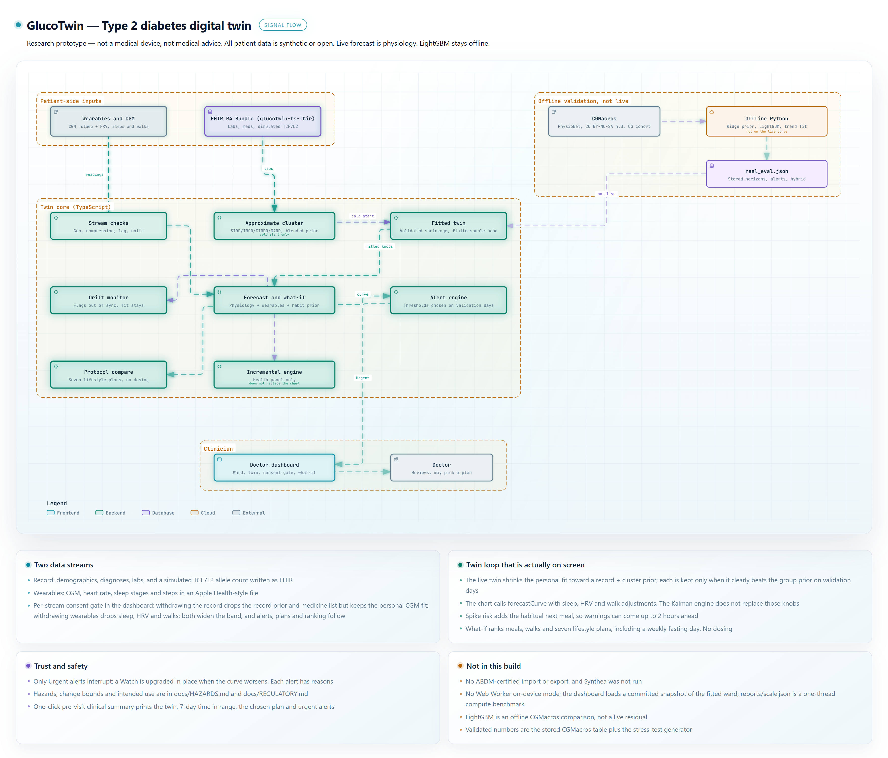
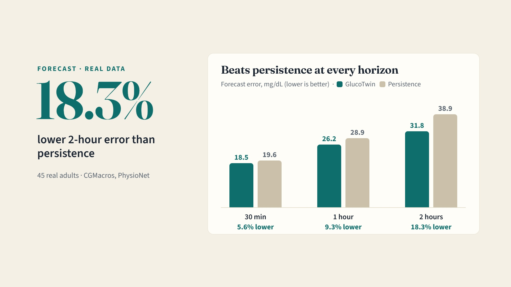

# GlucoTwin — A Digital Twin for Type 2 Diabetes

> GlucoTwin fuses a patient's FHIR health record with CGM and wearable streams (sleep, HRV, activity) to forecast glucose two hours ahead, warn before spikes with reasons, and let a doctor test lifestyle plans on the patient's own twin.

**Videos:** a 25-second overview is in this repository ([brag-output/brag.mp4](brag-output/brag.mp4)); the 15–20 minute demo is linked in [section 8](#8-demo-video).

**Real-World Data — CGMacros (45 Adults)**

| Headline | Result | Source |
| --- | --- | --- |
| 2-hour forecast error vs persistence | **18.3% lower** (31.8 vs 38.9 mg/dL); 95% participant-bootstrap interval 14.9–21.4% | [Forecast accuracy](#forecast-accuracy) |
| 1-hour and 30-min error vs persistence | 9.3% lower at 1 hour (26.2 vs 28.9); 5.6% lower at 30 min (18.5 vs 19.6) | [Forecast accuracy](#forecast-accuracy) |
| Health-record fusion | **12% lower** 1-hour error from labs, BMI, age and sex alone (30.4 → 26.8) | [Cold-start ablation](#cold-start-ablation-60-min-rmse) |
| Clinical accuracy | 99.8% of 30-min forecasts in Clarke zones A + B; the 10–90% band covers 0.79–0.81 of outcomes | [Forecast accuracy](#forecast-accuracy) |
| Spike warnings | 178 of 457 spikes warned (39%), 64% of spike alerts come true, median 35 min ahead; spike-risk AUROC 0.685 (95% CI 0.638–0.730) | [Alerts](#alerts) |
| Low warnings | 7 of 17 lows warned; 7 of 18 low alerts come true (39%); 0.43 false alerts per patient-day. Rule chosen leave-one-participant-out; low-risk AUROC 0.668 (0.507–0.819) | [Alerts](#alerts) |
| Risk calibration | Not a calibrated probability on real data: Brier score no better than always predicting the base rate (spike 0.162 vs 0.159; low 0.0035 vs 0.0031) | [Alerts](#alerts) |

**Simulated Stress-Test Ward (Seed 42)** — 11 synthetic patients, scored on days 10–21

| Headline | Result | Source |
| --- | --- | --- |
| Spike warnings | Median **105 min** ahead; 109 of 254 spikes warned 60+ min ahead, 33 a full 120 min; spike-risk AUROC 0.947 (0.916–0.970) | [Alerts](#alerts) |
| Urgent warnings | 125 of 185 severe events (peak > 250, an hour above 180, or a low) get an Urgent alert; 84% of Urgent alerts come true | [Alerts](#alerts) |
| Low warnings | 6 of 16 lows warned, all 6 low alerts correct, including 1 of 10 sulfonylurea lows. The drug guard is chosen on an independent realization of the ward, so this is a blind figure | [Alerts](#alerts), [reports/drug_guard_calibration.json](reports/drug_guard_calibration.json) |
| Against simple alarms | Highest F1 (0.638), level with a 60-min CGM trend alarm (0.637) at about a third of its false alarms | [docs/ALERT_PROOF.md](docs/ALERT_PROOF.md) |

**System & Clinical Workflow**

| Headline | Result | Source |
| --- | --- | --- |
| Built for India | IFCT 2017 foods; SIDD / IROD / CIRDD / MARD subgroup priors (approximate rule); English / हिन्दी plan table, plan reasons and printed summary | — |
| Scale | 16.3 µs per reading; 61,437 readings/s on one laptop thread; the dashboard rebuilds its fitted ward in about 0.2 s once its file arrives | [reports/scale.json](reports/scale.json) |
| Clinic workflow | Per-stream DPDP-style consent gate; Two-Stream Inspector showing what the twin does with each record field and wearable signal; one-click pre-visit clinical summary (print or PDF) | Doctor dashboard |
| Model card and CI | Intended use, population, equations, metrics, limits and guardrails in one page; typecheck, tests, Python parity and build run on every push | [docs/MODEL_CARD.md](docs/MODEL_CARD.md), [.github/workflows/ci.yml](.github/workflows/ci.yml) |

Research prototype — not a medical device, not medical advice. All patient data is synthetic or open.



## Submission checklist

| # | Form item | Where |
| --- | --- | --- |
| 1 | Team details | [Team details](#1-team-details) |
| 2 | College/Incubator information | [College / Incubator](#2-college--incubator-information) |
| 3 | Project Title | [Project title](#3-project-title) |
| 4 | Problem Statement | [Problem statement](#4-problem-statement) |
| 5 | Healthcare Use Case | [Healthcare use case](#5-healthcare-use-case) |
| 6 | Technical Stack | [Technical stack](#6-technical-stack) |
| 7 | AI/ML Model or Framework Details | [AI/ML details](#7-aiml-model-and-framework-details) |
| 8 | 15–20 minute demo video, unlisted on YouTube, linked here (plus a 25-second overview in the repo) | [Demo video](#8-demo-video) |
| 9 | Open-source licence details | [Licence](#9-open-source-licence-details) |
| 10 | Architecture diagram (PDF) | [docs/architecture/GlucoTwin_Architecture.pdf](docs/architecture/GlucoTwin_Architecture.pdf) |
| 11 | Presentation (PDF/PPT) covering project details and outcomes | [docs/presentation/GlucoTwin_Presentation.pdf](docs/presentation/GlucoTwin_Presentation.pdf) · [.pptx](docs/presentation/GlucoTwin_Presentation.pptx) |
| 12 | All files and links publicly accessible without extra permissions | [Public access](#12-public-access) |

## 1. Team details

**Team name:** GlucoTwin_RIMT-University

| Name | Role | Programme | GitHub |
| --- | --- | --- | --- |
| Nikhil Chawla (team leader) | AI Engineer | BCA – AI & Data Science, RIMT University | [@1nikhilchawla](https://github.com/1nikhilchawla) |

The team leader is a full-time student.

## 2. College / Incubator information

- College: **RIMT University**, Mandi Gobindgarh, Punjab, India.
- Incubator: not affiliated with an incubator.
- Faculty mentor: Dr. Rajkumar (Head of Department, Computer Applications, RIMT University).

## 3. Project title

**GlucoTwin — a personalised digital twin for Type 2 diabetes**

Per-stream, DPDP-style consent is simulated in the Doctor Dashboard. Withdrawing the health record drops the record prior and the medication list: the twin keeps its personal CGM fit, shrunk toward the group prior instead, and its uncertainty band widens (at least ×1.12). Withdrawing wearables removes the sleep, HRV and walk adjustments and widens the band ×1.1. Alerts, plans and the ward ranking follow the consented twin.

## 4. Problem statement

About 101 million adults in India were living with diabetes and about 136 million with prediabetes in the ICMR-INDIAB national survey (Anjana et al., Lancet Diabetes & Endocrinology, 2023, [doi:10.1016/S2213-8587(23)00119-5](https://doi.org/10.1016/S2213-8587(23)00119-5)).

Among people with self-reported diabetes in ICMR-INDIAB-13, 36.3% reached the glycaemic target and 7.7% reached the HbA1c, blood pressure and LDL targets together (Anjana et al., Lancet Diabetes & Endocrinology, 2022, [doi:10.1016/S2213-8587(22)00072-9](https://doi.org/10.1016/S2213-8587(22)00072-9)).

Nationwide, carbohydrates contributed 62.3% of total daily energy (Anjana et al., Nature Medicine, 30 September 2025, [doi:10.1038/s41591-025-03949-4](https://doi.org/10.1038/s41591-025-03949-4)). Replacing 5% of energy from carbohydrate with protein was associated with lower risk in that paper's model. Replacing refined cereals with whole wheat or millet without cutting carbohydrate quantity was not.

Clinic care often sees the result weeks later, at the next visit, rather than the spike or low that already happened.

This repository is a proof-of-concept twin that joins a health record to a wearable and CGM stream and scores whether a warning lands before the event. It is not a medical device.

## 5. Healthcare use case

- **Who:** a diabetologist or primary-care doctor reviewing adults with type 2 diabetes or prediabetes. The screen in this build is that review, not a patient treatment app.
- **When:** a simulated ward day, or a CGMacros recording, looked at between the visits the record already contains.
- **What the twin does:**
  - Forecasts glucose at 30, 60 and 120 minutes from the logged meals, walks, last night's sleep and HRV, and the fitted knobs, with a 10–90% conformal band.
  - Warns before spikes using the person's habitual next meal, and raises a low alert when the short curve crosses under 70 mg/dL.
  - Attaches a reason list to each alert (meals, walks and sleep still on the curve).
  - Ranks seven lifestyle plans (including a weekly fasting-day preset) on that person's fitted twin, applied to their highest-risk meal (breakfast, lunch or dinner): as logged, a 15-minute walk after the meal, a 5% net-carb cut made up with IFCT toor dal and paneer, the meal 60 minutes earlier, a split meal, jowar roti at the same carbohydrate grams, and one fasting day a week (with a warning to review glucose-lowering medicines first).
  - Labels the plan table "Simulation, not advice".
  - Lets the doctor withdraw consent per stream: without the record the twin keeps its personal CGM fit but falls back to the group prior and drops the medication list; without wearables it loses the sleep, HRV and walk adjustments. Either way the band widens on screen.
- **Two-Stream Inspector:** a collapsible panel on every patient screen ("Inspect the two input streams") lists the two inputs side by side. Stream 1 is the health record as the FHIR R4 resources the twin reads (Patient, Condition, Observation, MedicationRequest). Stream 2 is the wearable packet at the current minute (CGM, heart rate and METs, last night's sleep and HRV, steps, last logged walk). Each row states what the twin does with it, and the panel ends with the fitted knobs. When a stream's consent is withdrawn, its heading says the twin is not using it.
- **Modelled vs display-only streams:**

  | Input | Used by the twin | How |
  | --- | --- | --- |
  | CGM (5-min) | Yes | Anchor of every forecast and of the personal fit |
  | Logged meals (carbs, fibre, fat) | Yes | Meal rise, habit prior for spike risk |
  | Logged walks | Yes | Walk drop and a 12–30 h sensitivity lift |
  | Sleep duration and efficiency, HRV (RMSSD) | Yes | One multiplier on carb sensitivity and dawn rise, against the person's own HRV baseline |
  | Diagnosis, HbA1c, fasting glucose, fasting insulin (HOMA-IR), BMI, sex | Yes | Record prior; cluster label |
  | Age | Indirectly (simulated) / yes (CGMacros) | Simulated: only through the approximate MARD label (60 or older with HbA1c under 8.5%). CGMacros: an input of the ridge prior |
  | Medication list | Yes | Sulfonylurea term and low guard |
  | METs | CGMacros only | METs of 3 or more for 10 minutes or more become a walk; shown only on the simulated ward |
  | Heart rate, steps, sleep stages | No | Shown only. Sleep stages are a documented split of sleep duration for the Apple Health-style export, not measured |
  | Triglycerides, HDL, LDL | No | Listed only |
- **Print / export clinical summary:** a **Clinical summary** button on every patient screen prints a one-page pre-visit sheet, or saves it as PDF from the print dialog, for the patient's chart: current twin parameters (carb sensitivity, activity effect, fasting baseline, dawn rise, personal weight, forecast error and band), 7-day time in range against the week before, the doctor-selected or top-ranked lifestyle plan with its simulated change, and the last week's Urgent alerts with reasons and outcomes.
- **What it does not do:** medicine dosing or diagnosis.
- **One patient on the ward:** Ananya Rao (GT-07) is a simulated person. Her record card shows the approximate cluster rule that fired. The protocol table for her week is in the generated results below. The doctor can select a plan. The twin does not change a dose.

Research prototype — not a medical device, not medical advice. All patient data is synthetic or open.

## 6. Technical stack

Versions are the packages installed in this workspace (13 October 2026).

| Layer | Technology |
| --- | --- |
| Web app and doctor dashboard | TypeScript 5.9.3, React 19.3.0, TanStack Start 1.168.60, Recharts 2.15.4, Tailwind CSS 4.3.3, Zustand 5.0.15 |
| Twin engine | TypeScript. `forecastCurve` in `src/lib/glucotwin/physics.ts` draws the live chart. `src/lib/glucotwin/engine.ts` is an incremental state used by the twin-health panel. It does not replace the published five-day fit. There is no Web Worker: the dashboard loads a committed snapshot of the fitted simulated ward (`src/lib/glucotwin/ward_snapshot.json`, checked against a fresh fit by `npm test`), and loads the CGMacros series only when that source is chosen. |
| ML and validation | Python 3, numpy 2.2.6, pandas 2.3.3, scikit-learn 1.7.2, LightGBM 4.7.0. Offline only. See [ml/README.md](ml/README.md). |
| Health records | FHIR R4 JSON written by `src/lib/glucotwin/fhir.ts` (`glucotwin-ts-fhir`). Not Synthea. Not an ABDM-certified exchange. |
| Wearable stream | Simulated CGM, heart rate, sleep (duration, efficiency, stages), HRV and step counts. The twin uses CGM, logged walks, sleep duration and efficiency and HRV; heart rate, steps and stages are display-only (see the table in section 5). An Apple Health-style export is in `samples/apple_health_export.json`. Google Fit is not implemented. |
| Testing | `node:test` via `npm test` (`scripts/run-tests.mjs`; the same command works under sh and Windows cmd). Python parity is `npm run parity`: 15 shared functions × 20 cases within 1e-6. The same four gates run in GitHub Actions (`.github/workflows/ci.yml`). pytest is not the runner. |
| App runtime | Node.js 22.18.0 |

## 7. AI/ML model and framework details

Model card (intended use, population, equations, metrics, subgroup limits, guardrails): [docs/MODEL_CARD.md](docs/MODEL_CARD.md). Days are numbered from 1. Simulated ward: days 1–5 fit, 6–9 validation, 10–21 test (plans on 10–16). CGMacros: days 1–4 fit, 5–6 validation, day 7 onward test.

**Physiology forecast.** The on-screen curve is a meal model (carbohydrate, fiber and fat), a walk effect, a dawn rise and a decaying residual. Each meal's rise is scaled by a meal clock, C(h) = 1 + 0.14·sin(2π(h − 14)/24) + 0.10·sin(π(h − 4)/5) for 4 ≤ h ≤ 9, and by a size factor 1 + 0.003·max(0, carbs − 40), so an earlier or split meal changes time in range and the mean, not only the peak. These factors are a modelling assumption: on CGMacros validation days 5–6 they raised 60-min error (30.8 with, 28.0 without), so the real-data twin runs without them (`mealClock` in `real_eval.json`). A second switch, `mealResidual`, reads a meal that has risen less than modelled as proportionally smaller, so the shortfall scales that meal's remaining curve instead of decaying on its own and cannot drag the forecast below baseline as the meal fades. Validation days chose it for CGMacros (60-min RMSE 26.3 with, 28.0 without) and rejected it for the simulated ward (23.25 with, 21.2 without). LightGBM is not added to that curve.

**Offline residual model.** On CGMacros, LightGBM was fit to the physiology residual at 30, 60 and 120 minutes and stored in `real_eval.json` under `hybrid`. Three participants were held out of that fit. The live dashboard does not call it.

**Personalisation.** Days 1–5 fit carb sensitivity, activity effect, fasting glucose, dawn amplitude and meal time-constant. How far each patient moves from the record prior (0–100%) is chosen on held-out validation days 6–9, so low-variance patients stay near the prior. Floor: unless that blend beats its prior by more than one standard error of the day-by-day error difference on those days, the personal weight is 0. The live twin shrinks toward a record prior: the record + cluster formula blended with the group prior by inverse error variance, learned leave-one-out on fitting days. A second floor falls back to the group prior unless the record-based twin also beats it by more than one standard error on the validation days. Withdrawing the record keeps the personal CGM fit, shrunk toward the group prior instead. On CGMacros the live twin uses the same trust rule toward the group prior, anchored at the person's measured overnight fasting level. The subgroup rule (SIDD / IROD / CIRDD / MARD, `docs/CLUSTERS.md`) is an approximate decision list, not the published INSPIRED clustering. On CGMacros the prior is a leave-one-out ridge on labs, BMI, age and sex. On the simulated ward the record formula (`ehr.ts::ehrPrior`) uses HbA1c, fasting glucose, HOMA-IR, BMI and sex; age has no term of its own and acts only through the approximate cluster label (MARD, 60 or older with HbA1c under 8.5%), whose fixed shift is added to the prior.

**Wearable fusion.** Last night's sleep, sleep efficiency and HRV (against the person's own baseline), plus half of the night before, scale carb sensitivity and the dawn rise for the whole day; walks raise insulin sensitivity for 12–30 hours afterwards. In the simulated ward these effects sit at the upper end of published sleep-restriction and exercise studies (about a quarter lower insulin sensitivity after a 4-hour night); the stress-test generator uses a different shape and carry-over than the twin. The record's medication list switches on a sulfonylurea term: glucose falls once the gap since the last meal passes 3 hours in the afternoon and evening (to −48 mg/dL by 260 minutes) and 5 hours overnight (to −35 mg/dL), and meal rises shrink to 0.75×. The stress-test generator uses a −55 / −40 mg/dL step at 4 and 6 hours and 0.7×, so the twin's term is close to it and simulated drug lows are partly caught by construction. The term (`twinMedOffset`) was written from the generator's documented drug step and sulfonylurea pharmacodynamics; it is not fitted to any day of the scored ward. Heart rate, steps and sleep stages are displayed but not modelled.

**Anticipation.** Spike risk includes the person's habitual next meal (median time and size from the fitting days, within the next 120 minutes, never using future logs). Spike and low thresholds are chosen on validation days. On CGMacros a short-horizon trend correction, learned leave-one-participant-out, is added to the forecast; its coefficients are stored in `real_eval.json`. Lows on CGMacros also use a guarded CGM trend rule. As chosen, it fires only at or under 85 mg/dL, or at or under 92 with no meal of 15 g or more in the last 2 hours, when CGM fell at least 1 mg/dL/min over 15 minutes and the damped (10-minute) 15-minute projection, averaged with the twin's 30-minute trough, is under 70. The fall rate, damping, both guard ceilings and whether the twin's post-meal guard applies were picked from 36 candidates leave-one-participant-out: each participant is scored with the candidate that had the best pooled low-alert F1 on the other 44, so no participant's own scored days choose their rule. All 45 folds picked the same candidate (`lowRule` in `real_eval.json`). The candidate values were first proposed after looking at test-day false alarms of an earlier run, so the grid is not fully blind even though each participant's choice is. The dashboard's CGMacros participants use the same rule; the simulated ward does not. On the simulated ward the low threshold is the highest validation-day recall with precision at least 0.8, and the twin's own low risk is switched off above 92 mg/dL within 2 hours of a meal of 15 g or more unless a glucose-lowering drug is active. For a simulated patient on a sulfonylurea, a low guard (`DRUG_LOW_GUARD`) assumes the rest of the fasting-gap fall arrives within the hour from 15:00 to 06:00 once glucose is under 105 mg/dL and the gap since the last logged meal reaches 240 minutes, or when CGM falls at least 1 mg/dL/min after an unlogged snack. No drug low falls on a validation day, so those values are chosen on an independent realization of the ward (every persona seed + 1000; there GT-31 has 11 drug lows on days 16–21) from a pre-specified grid of 48 guards and "no guard", by the highest low recall with precision at least 0.8 (`npm run calibrate:drug-guard`, [reports/drug_guard_calibration.json](reports/drug_guard_calibration.json); `npm test` fails if `DRUG_LOW_GUARD` differs from that choice). The scored days 10–21 of seed 42 never informed the guard or `twinMedOffset`. The chosen guard is conservative: it catches 1 of 11 lows on the calibration realization and 1 of GT-31's 10 drug lows on the scored ward.

**Uncertainty.** The band is a split-conformal 10th–90th percentile of residuals with the finite-sample order statistics (⌊(n+1)·0.1⌋ and ⌈(n+1)·0.9⌉ of n), fit after the knobs and before the scored days. On CGMacros the leave-one-participant-out trend correction is applied first and the band is refit on the corrected residuals.

**Adverse events.** The 70 and 180 mg/dL limits are the consensus time-in-range targets for CGM (Battelino et al., Diabetes Care 2019, [doi:10.2337/dci19-0028](https://doi.org/10.2337/dci19-0028)) used in the ADA Standards of Care in Diabetes (Section 6, Glycemic Goals and Hypoglycemia, [doi:10.2337/dc25-S006](https://doi.org/10.2337/dc25-S006)); 250 mg/dL is the same consensus's level 2 high. A spike is the first reading above 180 mg/dL after 60 minutes at or below, or a rise of at least 50 mg/dL above the pre-meal reading inside 2 hours, then de-duplicated. A low is the first reading under 70 mg/dL after 30 minutes at or above. An alert fires when risk crosses a threshold chosen on validation days (spike risk 0.8 in this build) and clears when risk falls below two-thirds of it, with a suppression cap. Urgent means a low, a curve peak above 250 mg/dL, or at least 60 minutes above 180 mg/dL. Everything else on that list is Watch, and an active Watch is upgraded to Urgent in place when the live curve later meets those criteria (usually once the meal is logged). Urgent recall is scored against clinically severe events (a true peak above 250, at least 60 minutes above 180 within 3 hours, or any low), counting each alert from the moment it became Urgent. The banner interrupts only for Urgent.

**Validation.** Three tiers are tabulated: CGMacros (United States, Santa Barbara), a mismatched stress-test generator, and a matched generator that shares the twin's equations (an upper bound, not a transfer result). Metrics that were computed are printed below. Lead time is the gap from the first in-window alert to the event. The spike window is 120 minutes and the low window is 60 minutes, so no reported lead can exceed 120 minutes: the scorer caps it there. Lead time is reported for spikes.

<!-- RESULTS:START -->
Tables below are printed from `reports/sim_eval.json` and `src/lib/glucotwin/real/real_eval.json`. RMSE, MAE and MARD are mg/dL. Coverage and recall are fractions from 0 to 1. A dash means that field is not stored.

### Forecast accuracy

| Tier | Horizon (min) | Twin RMSE | Persistence RMSE | Population RMSE | MAE | MARD | Coverage | Clarke A+B | n |
| --- | ---: | ---: | ---: | ---: | ---: | ---: | ---: | ---: | ---: |
| CGMacros (real) | 30 | 18.5 | 19.6 | 20.5 | 12.4 | 8.6 | 0.805 | 0.998 | 11101 |
| CGMacros (real) | 60 | 26.2 | 28.9 | 30.3 | 17.7 | 12.3 | 0.794 | — | 11102 |
| CGMacros (real) | 120 | 31.8 | 38.9 | 39.8 | 22.0 | 15.2 | 0.789 | — | 11101 |

| Tier | Horizon (min) | Twin RMSE | Persistence RMSE | Population RMSE | MAE | MARD | Coverage | Clarke A+B | n |
| --- | ---: | ---: | ---: | ---: | ---: | ---: | ---: | ---: | ---: |
| Simulated mismatched | 30 | 13.5 | 20.4 | 14.5 | 7.9 | 5.7 | 0.788 | 0.985 | 6317 |
| Simulated mismatched | 60 | 22.9 | 31.2 | 24.6 | 12.1 | 8.5 | 0.765 | — | 6306 |
| Simulated mismatched | 120 | 28.1 | 37.4 | 31.1 | 15.3 | 10.5 | 0.766 | — | 6284 |

| Tier | Horizon (min) | Twin RMSE | Persistence RMSE | Population RMSE | MAE | MARD | Coverage | Clarke A+B | n |
| --- | ---: | ---: | ---: | ---: | ---: | ---: | ---: | ---: | ---: |
| Simulated matched (upper bound) | 30 | 6.3 | 16.1 | 8.0 | 4.2 | 3.4 | 0.772 | 0.992 | 6325 |
| Simulated matched (upper bound) | 60 | 15.5 | 26.5 | 17.8 | 7.4 | 5.5 | 0.771 | — | 6314 |
| Simulated matched (upper bound) | 120 | 25.3 | 36.4 | 28.9 | 13.1 | 8.9 | 0.78 | — | 6292 |

CGMacros choices, all made on validation days 5–6: Meal-scaled residual on (validation 60-min RMSE 26.3 scaled, 28 plain). Meal clock and size factors off for CGMacros (validation 60-min RMSE 30.8 on, 28 off). Personal weight per participant (1.0: 12, 0.75: 0, 0.5: 0, 0.25: 0, 0.0: 33). Trend correction pooled on everyone's uncorrected test rows: 30 min gain 0.161, bias 1.71; 60 min gain 0.0905, bias 3.218; 120 min gain 0.0318, bias 5.663. Each participant's own forecast uses leave-one-participant-out coefficients, and their band is refit after the correction.

Simulated ward, validation days 6–9: meal-scaled residual off (60-min RMSE 23.25 scaled, 21.2 plain).

### Groups at 60 min

| Tier | Group | Patients | 60-min twin RMSE | 60-min persistence RMSE | Improvement % |
| --- | --- | ---: | ---: | ---: | ---: |
| CGMacros (real) | t2d | 14 | 32.0 | 35.5 | 9.9 |
| CGMacros (real) | prediabetes | 16 | 25.0 | 27.6 | 9.4 |
| CGMacros (real) | healthy | 15 | 21.0 | 22.9 | 8.3 |

| Tier | Group | Patients | 60-min twin RMSE | 60-min persistence RMSE | Improvement % |
| --- | --- | ---: | ---: | ---: | ---: |
| Simulated mismatched | t2d | 8 | 26.3 | 35.8 | 26.4 |
| Simulated mismatched | prediabetes | 2 | 9.5 | 14.1 | 32.1 |
| Simulated mismatched | healthy | 1 | 7.0 | 8.9 | 21.4 |

### Alerts

Wilson 95% intervals use the stored hit counts. False alerts per patient-day on the low row is the same pooled figure as the spike row. Lead time is reported for spikes only. The scorer counts an alert as a hit only inside its window (120 min before a spike, 60 min before a low), so no reported lead can exceed 120 min. Urgent recall counts an alert from the moment it became Urgent, including a Watch upgraded in place. On CGMacros the low risk also includes a guarded CGM trend rule. The rule and its guard values are chosen leave-one-participant-out: each participant is scored with the candidate that did best on the other participants (`lowRule` in `real_eval.json`), so no participant's own test days choose their rule. On the simulated ward the sulfonylurea low guard is chosen on an independent realization of the ward (`reports/drug_guard_calibration.json`), so the scored days never informed it.

| Tier | Kind | Events | Alerts | Hits | Recall | Recall Wilson 95% | Precision | Precision Wilson 95% | False alerts / patient-day | Median lead (min) | Lead IQR (min) |
| --- | --- | ---: | ---: | ---: | ---: | --- | ---: | --- | ---: | ---: | --- |
| CGMacros (real) | Spike | 457 | 282 | 178 | 0.389 | 0.346 to 0.435 | 0.638 | 0.581 to 0.692 | 0.43 | 35 | 20 to 60 |
| CGMacros (real) | Low | 17 | 18 | 7 | 0.412 | 0.216 to 0.64 | 0.389 | 0.203 to 0.614 | 0.43 | — | — |

CGMacros spike events warned at least 30 min ahead: 115 of 457 (share 0.252). At least 60 min: 49 (share 0.107). At least 120 min: 5 (share 0.011).

| Tier | Kind | Events | Alerts | Hits | Recall | Recall Wilson 95% | Precision | Precision Wilson 95% | False alerts / patient-day | Median lead (min) | Lead IQR (min) |
| --- | --- | ---: | ---: | ---: | ---: | --- | ---: | --- | ---: | ---: | --- |
| Simulated mismatched | Spike | 254 | 299 | 155 | 0.61 | 0.549 to 0.668 | 0.669 | 0.614 to 0.72 | 0.75 | 105 | 50 to 115 |
| Simulated mismatched | Low | 16 | 6 | 6 | 0.375 | 0.185 to 0.614 | 1 | 0.61 to 1 | 0.75 | — | — |
| Simulated mismatched | Urgent, severe events (peak > 250, ≥ 60 min > 180, or a low) | 185 | 230 | 125 | 0.676 | 0.605 to 0.739 | 0.835 | 0.781 to 0.877 | 1.7 | — | — |
| Simulated mismatched | Urgent, all events (for comparison) | 270 | 230 | 148 | 0.548 | 0.489 to 0.606 | — | — | — | — | — |
| Simulated mismatched | Watch alerts | — | 75 | — | — | — | — | — | 0.6 | — | — |

Spike events with a first alert at least 60 min earlier: 109 of 254 (share 0.429). At least 120 min: 33 of 254 (share 0.13). Low events at least 60 min: 0 of 16 (share 0). Share of events whose first matching alert falls inside the scorer window and is at least this many minutes earlier. Spike window is 120 min. Low window is 60 min. A miss counts as not warned. This is not a share beyond the window.

Discrimination and calibration of the continuous risk the alerts threshold. Steps are 5-min test-day steps where the outcome is defined (at or under 180 for spikes, at or over 70 for lows). Intervals come from a participant (CGMacros) or patient (simulated) bootstrap.

| Data | Risk | Scored steps | Base rate | AUROC (95% CI) | AUPRC (95% CI) | Brier (always base rate) | ECE |
| --- | --- | ---: | ---: | ---: | ---: | ---: | ---: |
| CGMacros (real) | Spike, next 120 min | 56943 | 0.1986 | 0.685 (0.638–0.730) | 0.373 (0.315–0.436) | 0.1621 (0.1592) | 0.115 |
| CGMacros (real) | Low, next 60 min | 66385 | 0.0031 | 0.668 (0.507–0.819) | 0.061 (0.014–0.148) | 0.0035 (0.0031) | 0.003 |
| Simulated mismatched | Spike, next 120 min | 33128 | 0.1930 | 0.947 (0.916–0.970) | 0.853 (0.751–0.911) | 0.0615 (0.1555) | 0.028 |
| Simulated mismatched | Low, next 60 min | 37105 | 0.0060 | 0.853 (0.796–0.905) | 0.395 (0.303–0.532) | 0.0049 (0.0064) | 0.004 |

### Cold-start ablation (60-min RMSE)

CGMacros ridge ablation. The ridge is not shifted by the cluster rule.

| Id | Label | 60-min RMSE | n |
| --- | --- | ---: | ---: |
| none | No EHR | 30.4 | 11192 |
| group | Group only | 30.3 | 11192 |
| ehr | EHR prior | 26.8 | 11192 |
| ehrPersonal | EHR prior + personal calibration | 26.4 | 11192 |

Simulated ward. The record arm includes the approximate cluster shift.

| Id | Label | 60-min RMSE | n |
| --- | --- | ---: | ---: |
| none | No EHR | 28.5 | 6306 |
| group | Group only | 24.6 | 6306 |
| ehr | Record + cluster | 24.5 | 6306 |
| ehrPersonal | Record + cluster + personal calibration | 22.9 | 6306 |

Record + cluster 60-min RMSE 24.5 is lower than Group only 24.6.

Streams removed one at a time on the simulated mismatched ward. For the six main arms the alerts are rebuilt with that arm's knobs, stream mask and medicine term (no cached risk) and scored on days 10–21.

| Id | Label | 60-min RMSE | n | Spike F1 | Lows warned | Urgent recall (severe events) |
| --- | --- | ---: | ---: | ---: | ---: | ---: |
| full | All streams | 22.91 | 6306 | 0.638 | 6 of 16 | 125 of 185 (0.676) |
| noRecord | No record (group prior + personal fit, no medicine term) | 22.81 | 6306 | 0.639 | 3 of 16 | 121 of 185 (0.654) |
| noRecordNoPersonal | No record and no personal fit (group prior only) | 24.57 | 6306 | 0.677 | 0 of 16 | 117 of 185 (0.632) |
| noMeals | No meals | 26.40 | 6306 | — | 5 of 16 | 5 of 185 (0.027) |
| noActivity | No activity | 22.97 | 6306 | 0.647 | 1 of 16 | 121 of 185 (0.654) |
| noSleep | No sleep or HRV | 22.89 | 6306 | 0.661 | 6 of 16 | 122 of 185 (0.659) |
| fullHardNight | All streams, days after a short or stressed night | 23.58 | 2434 | — | — | — |
| noSleepHardNight | No sleep or HRV, days after a short or stressed night | 23.57 | 2434 | — | — | — |
| fullHardNightMeal | All streams, 2 h after a meal following a short or stressed night | 21.59 | 606 | — | — | — |
| noSleepHardNightMeal | No sleep or HRV, 2 h after a meal following a short or stressed night | 21.86 | 606 | — | — | — |
| fullAfterWalk | All streams, 6 h after a walk | 15.83 | 833 | — | — | — |
| noActivityAfterWalk | No activity, 6 h after a walk | 16.44 | 833 | — | — | — |

No meals 60-min RMSE 26.40 is higher than Full 22.91.
No activity 60-min RMSE 22.97 is higher than Full 22.91.
No sleep 60-min RMSE 22.89 is lower than Full 22.91.
No record (group prior + personal fit, no medicine term) 60-min RMSE 22.81 is lower than Full 22.91.
No record and no personal fit 60-min RMSE 24.57 is higher than Full 22.91.
No sleep, 2 h after a meal following a hard night, 60-min RMSE 21.86 is higher than Full 21.59.
No activity, 6 h after a walk, 60-min RMSE 16.44 is higher than Full 15.83.

### Low-cost fingersticks

RMSE of interpolating a few daily fingersticks against the full CGM grid on the simulated ward. This is not the twin's forecast error.

| Pricks per day | RMSE |
| ---: | ---: |
| 2 | 27.3 |
| 4 | 26.9 |
| 6 | 21.2 |
| 8 | 20.3 |
| 288 | 0.0 |

### Personal 60-min RMSE

Gain is population RMSE minus this person's twin RMSE. A negative gain is worse than the group prior.

| Id | Name | Group | Cluster | Twin RMSE | Population RMSE | Gain |
| --- | --- | --- | --- | ---: | ---: | ---: |
| GT-07 | Ananya Rao | t2d | IROD | 24.0 | 24.9 | 0.9 |
| GT-12 | Vikram Shah | t2d | MARD | 14.4 | 15.4 | 1.0 |
| GT-03 | Kavita Deshmukh | t2d | MARD | 20.2 | 22.8 | 2.6 |
| GT-19 | Fatima Khan | t2d | CIRDD | 34.0 | 37.0 | 3.0 |
| GT-21 | Suresh Patel | t2d | IROD | 20.8 | 22.0 | 1.2 |
| GT-05 | Meera Iyer | prediabetes | none | 10.2 | 10.2 | 0.0 |
| GT-28 | Arjun Nair | prediabetes | none | 8.8 | 9.1 | 0.3 |
| GT-02 | Rohan Gupta | healthy | none | 7.0 | 7.0 | 0.0 |
| GT-31 | Divya Menon | t2d | SIDD | 24.0 | 24.5 | 0.5 |
| GT-33 | Imran Qureshi | t2d | SIDD | 15.2 | 16.8 | 1.6 |
| GT-36 | Leela Joshi | t2d | CIRDD | 44.2 | 47.9 | 3.7 |

### Protocol compare (simulated, days 10–16, 5-min grid)

Ranked on the fitted twin. Each plan edits the patient's highest-risk meal slot. No dosing. As-logged stays first. The other rows follow the gain in `rankPlans`: one point of time in range equals 14.4 minutes above 180, and a minute under 70 counts as 3 minutes above 180 (6 for a patient on a glucose-lowering drug or with lows in the as-logged week).

| Id | Name | Plan | Time in range % | Min above 180 | Min under 70 | Mean mg/dL |
| --- | --- | --- | ---: | ---: | ---: | ---: |
| GT-07 | Ananya Rao | As logged | 79 | 2115 | 0 | 165.4 |
| GT-07 | Ananya Rao | Fasting day once a week | 81.3 | 1890 | 0 | 163.9 |
| GT-07 | Ananya Rao | Walk 15 min after lunch | 81 | 1920 | 0 | 163.1 |
| GT-07 | Ananya Rao | Dal and paneer for 5% of lunch carbs | 79.3 | 2090 | 0 | 165 |
| GT-07 | Ananya Rao | Lunch 60 min earlier | 79.1 | 2105 | 0 | 165.2 |
| GT-07 | Ananya Rao | Jowar roti at lunch, same carbs | 79.1 | 2105 | 0 | 165.2 |
| GT-07 | Ananya Rao | Split lunch | 76.5 | 2365 | 0 | 165 |
| GT-12 | Vikram Shah | As logged | 95.8 | 420 | 0 | 145.6 |
| GT-12 | Vikram Shah | Split lunch | 99.4 | 65 | 0 | 145.5 |
| GT-12 | Vikram Shah | Walk 15 min after lunch | 99.3 | 75 | 0 | 144.1 |
| GT-12 | Vikram Shah | Fasting day once a week | 96.4 | 365 | 0 | 144.8 |
| GT-12 | Vikram Shah | Dal and paneer for 5% of lunch carbs | 96.3 | 370 | 0 | 145.4 |
| GT-12 | Vikram Shah | Lunch 60 min earlier | 96.3 | 375 | 0 | 145.4 |
| GT-12 | Vikram Shah | Jowar roti at lunch, same carbs | 96.1 | 390 | 0 | 145.5 |
| GT-03 | Kavita Deshmukh | As logged | 96.9 | 310 | 0 | 122.9 |
| GT-03 | Kavita Deshmukh | Split lunch | 99.8 | 25 | 0 | 122.7 |
| GT-03 | Kavita Deshmukh | Walk 15 min after lunch | 99.7 | 30 | 0 | 120.9 |
| GT-03 | Kavita Deshmukh | Dal and paneer for 5% of lunch carbs | 97.6 | 245 | 0 | 122.6 |
| GT-03 | Kavita Deshmukh | Lunch 60 min earlier | 97.3 | 270 | 0 | 122.7 |
| GT-03 | Kavita Deshmukh | Jowar roti at lunch, same carbs | 97.3 | 275 | 0 | 122.8 |
| GT-03 | Kavita Deshmukh | Fasting day once a week | 97 | 300 | 0 | 122 |
| GT-19 | Fatima Khan | As logged | 62.1 | 3825 | 0 | 182.8 |
| GT-19 | Fatima Khan | Fasting day once a week | 64.8 | 3550 | 0 | 181.5 |
| GT-19 | Fatima Khan | Walk 15 min after lunch | 62.7 | 3755 | 0 | 179.8 |
| GT-19 | Fatima Khan | Dal and paneer for 5% of lunch carbs | 62.3 | 3805 | 0 | 182.4 |
| GT-19 | Fatima Khan | Lunch 60 min earlier | 62.2 | 3815 | 0 | 182.6 |
| GT-19 | Fatima Khan | Jowar roti at lunch, same carbs | 62 | 3835 | 0 | 182.8 |
| GT-19 | Fatima Khan | Split lunch | 58 | 4235 | 0 | 182.4 |
| GT-21 | Suresh Patel | As logged | 77.4 | 2280 | 0 | 168.8 |
| GT-21 | Suresh Patel | Fasting day once a week | 79.9 | 2030 | 0 | 167.2 |
| GT-21 | Suresh Patel | Walk 15 min after lunch | 79.3 | 2085 | 0 | 166.6 |
| GT-21 | Suresh Patel | Dal and paneer for 5% of lunch carbs | 77.6 | 2260 | 0 | 168.4 |
| GT-21 | Suresh Patel | Jowar roti at lunch, same carbs | 77.5 | 2265 | 0 | 168.7 |
| GT-21 | Suresh Patel | Lunch 60 min earlier | 77.5 | 2270 | 0 | 168.6 |
| GT-21 | Suresh Patel | Split lunch | 74.5 | 2575 | 0 | 168.3 |
| GT-05 | Meera Iyer | As logged | 100 | 0 | 0 | 113 |
| GT-05 | Meera Iyer | Walk 15 min after lunch | 100 | 0 | 0 | 111.7 |
| GT-05 | Meera Iyer | Fasting day once a week | 100 | 0 | 0 | 112.5 |
| GT-05 | Meera Iyer | Dal and paneer for 5% of lunch carbs | 100 | 0 | 0 | 112.9 |
| GT-05 | Meera Iyer | Lunch 60 min earlier | 100 | 0 | 0 | 112.9 |
| GT-05 | Meera Iyer | Jowar roti at lunch, same carbs | 100 | 0 | 0 | 112.9 |
| GT-05 | Meera Iyer | Split lunch | 100 | 0 | 0 | 113 |
| GT-28 | Arjun Nair | As logged | 100 | 0 | 0 | 106.9 |
| GT-28 | Arjun Nair | Walk 15 min after lunch | 100 | 0 | 0 | 105.8 |
| GT-28 | Arjun Nair | Fasting day once a week | 100 | 0 | 0 | 106.5 |
| GT-28 | Arjun Nair | Dal and paneer for 5% of lunch carbs | 100 | 0 | 0 | 106.8 |
| GT-28 | Arjun Nair | Lunch 60 min earlier | 100 | 0 | 0 | 106.8 |
| GT-28 | Arjun Nair | Split lunch | 100 | 0 | 0 | 106.9 |
| GT-28 | Arjun Nair | Jowar roti at lunch, same carbs | 100 | 0 | 0 | 107.1 |
| GT-02 | Rohan Gupta | As logged | 100 | 0 | 0 | 95.6 |
| GT-02 | Rohan Gupta | Walk 15 min after lunch | 100 | 0 | 0 | 94.7 |
| GT-02 | Rohan Gupta | Fasting day once a week | 100 | 0 | 0 | 95.1 |
| GT-02 | Rohan Gupta | Dal and paneer for 5% of lunch carbs | 100 | 0 | 0 | 95.5 |
| GT-02 | Rohan Gupta | Lunch 60 min earlier | 100 | 0 | 0 | 95.5 |
| GT-02 | Rohan Gupta | Split lunch | 100 | 0 | 0 | 95.5 |
| GT-02 | Rohan Gupta | Jowar roti at lunch, same carbs | 100 | 0 | 0 | 95.5 |
| GT-31 | Divya Menon | As logged | 95.5 | 410 | 45 | 132.5 |
| GT-31 | Divya Menon | Split lunch | 98.3 | 170 | 0 | 132.8 |
| GT-31 | Divya Menon | Walk 15 min after lunch | 97.9 | 170 | 45 | 130.8 |
| GT-31 | Divya Menon | Fasting day once a week | 96.1 | 350 | 45 | 131.3 |
| GT-31 | Divya Menon | Dal and paneer for 5% of lunch carbs | 96 | 355 | 45 | 132.2 |
| GT-31 | Divya Menon | Lunch 60 min earlier | 95.8 | 375 | 45 | 132 |
| GT-31 | Divya Menon | Jowar roti at lunch, same carbs | 95.7 | 385 | 45 | 132.3 |
| GT-33 | Imran Qureshi | As logged | 98.3 | 170 | 0 | 134.1 |
| GT-33 | Imran Qureshi | Walk 15 min after lunch | 100 | 0 | 0 | 132.6 |
| GT-33 | Imran Qureshi | Split lunch | 100 | 5 | 0 | 134.1 |
| GT-33 | Imran Qureshi | Dal and paneer for 5% of lunch carbs | 98.7 | 135 | 0 | 133.9 |
| GT-33 | Imran Qureshi | Lunch 60 min earlier | 98.7 | 135 | 0 | 134 |
| GT-33 | Imran Qureshi | Fasting day once a week | 98.3 | 170 | 0 | 133.5 |
| GT-33 | Imran Qureshi | Jowar roti at lunch, same carbs | 98.2 | 180 | 0 | 134.2 |
| GT-36 | Leela Joshi | As logged | 51.9 | 4845 | 0 | 193.1 |
| GT-36 | Leela Joshi | Fasting day once a week | 55.2 | 4520 | 0 | 191.6 |
| GT-36 | Leela Joshi | Walk 15 min after lunch | 52.3 | 4810 | 0 | 189.6 |
| GT-36 | Leela Joshi | Dal and paneer for 5% of lunch carbs | 51.9 | 4845 | 0 | 192.6 |
| GT-36 | Leela Joshi | Lunch 60 min earlier | 51.9 | 4845 | 0 | 192.8 |
| GT-36 | Leela Joshi | Jowar roti at lunch, same carbs | 51.9 | 4845 | 0 | 193.1 |
| GT-36 | Leela Joshi | Split lunch | 46.5 | 5390 | 0 | 192.4 |

### Offline LightGBM residual (CGMacros only, not on the live curve)

| Horizon (min) | CV twin RMSE | CV hybrid RMSE | Held-out people | Held-out twin RMSE | Held-out hybrid RMSE |
| ---: | ---: | ---: | ---: | ---: | ---: |
| 30 | 18.2 | 17.4 | 3 | 24.4 | 22.3 |
| 60 | 25.5 | 24.6 | 3 | 37.2 | 34.2 |
| 120 | 31.0 | 29.7 | 3 | 46.5 | 40.8 |

### Scale

| Field | Value |
| --- | --- |
| measuredAt | 2026-10-17 |
| node | v22.18.0 |
| cpu | 11th Gen Intel(R) Core(TM) i5-11400H @ 2.70GHz |
| threads | 1 |
| patients | 3000 |
| readingsPerPatient | 288 |
| cycles | 864000 |
| microsecondsPerReading | 16.3 |
| readingsPerSecondOneThread | 61437 |
| patientsPerThreadAt5MinCadence | 18430965 |
| meanStateBytes | 1710 |
| forecastAtMedianMicroseconds | 14 |
| forecastAtP95Microseconds | 29 |
| rankPlansMedianMs | 10.9 |
| rankPlansMaxMs | 30.8 |
| wardSnapshotKb | 1030 |
| wardSnapshotHydrateMs | 229 |
| realWardLoadMs | 274 |
| simWardFitMs | 2415 |
| cohortEvaluationMs | 9597 |
| note | Compute only, one thread, Node; excludes network and database time. Engine loop = update + 2-hour forecast + spike risk per reading. The app loads the ward snapshot (hydrate) and, on the toggle, the CGMacros file; the fit and the cohort evaluation run only in scripts and tests. Browser timings are in docs/CHANGELOG_EVAL.md. |

<!-- RESULTS:END -->

### Alerts against simple alarms (simulated stress test)

`npm run alert-proof` scores the twin's live spike alerts and five simple alarms on the same 254 stress-test spikes, with the same alert hygiene and scorer as above, and writes [docs/ALERT_PROOF.md](docs/ALERT_PROOF.md).

| Method | Recall | Precision | F1 | False alerts / patient-day | Median lead (min) | Warned ≥ 60 min |
| --- | ---: | ---: | ---: | ---: | ---: | ---: |
| **GlucoTwin (live, risk ≥ 0.8)** | 61.0% | 66.9% | **0.638** | 0.75 | **105** | **109** |
| Rise-rate alarm (CGM only) | 24.8% | 78.8% | 0.377 | 0.13 | 5 | 0 |
| Trend projection, 60 min (CGM only) | 89.4% | 49.5% | 0.637 | 2.11 | 25 | 67 |
| Trend projection, 120 min (CGM only) | 81.5% | 34.5% | 0.485 | 3.86 | 45 | 91 |
| Big-meal rule, ≥ 40 g carbs | 56.7% | 58.5% | 0.576 | 0.77 | 30 | 5 |

The twin and the 60-minute trend alarm are level on F1. The twin warns earlier (median 105 vs 25 minutes) with about a third of the false alarms (0.75 vs 2.11 per patient-day).

## 7a. Real-World Indian OPD Scenarios

Five situations an Indian OPD diabetologist meets in a short slot, each tied to the code that handles it.

| # | Scenario | What the doctor sees | Code path |
|---|---|---|---|
| 1 | **High-carb Indian lunch and a protein swap (ICMR-INDIAB)** | Rice and roti at lunch drive the day's biggest rise. Would swapping some carbohydrate for dal and paneer, or rice for jowar roti, help this patient? | `protocol.ts::rankPlans` scores seven plans on the patient's fitted twin at the highest-risk meal, and `buildWhy` adds a one-line reason. For Ananya (GT-07): "This patient's carb sensitivity is 1.18× the Type 2 group average (14.2 vs 12.0), so a 5% carb cut at lunch with dal and paneer moves this twin more than an average one." Jowar roti at the same carbs is listed with the Nature Medicine 2025 finding of no risk drop. |
| 2 | **Sulfonylurea and a fasting day** | Divya Menon (GT-31, 42, Type 2, SIDD cluster) is on a simulated sulfonylurea from day 16 and asks about fasting once a week. | The twin's drug term and low guard (`cohort.ts::twinMedOffset`, `DRUG_LOW_GUARD`) read the medication list; her low alerts lead with a Medicine reason. The fasting-day plan carries "A glucose-lowering drug on the medication list could push a fasting-day low under 70. Review the medicines with the prescriber first." Plan gain counts each of her minutes under 70 as 6 minutes above 180. Her drug guard, chosen on an independent realization of the ward, catches 1 of her 10 drug lows (ward total: 6 of 16 lows, all 6 alerts correct). |
| 3 | **Night-time compression low** | Lying on the sensor during sleep can produce a sharp false low. Real low or artefact? | Each reading carries a `compressionLow` flag. Flagged minutes are kept out of the twin and out of scored events; the Split view says "This minute is a compression low. It is kept out of the twin." and the Night view counts compression minutes. Covered in `src/lib/glucotwin/logic.test.ts`. |
| 4 | **Step-down from CGM to fingersticks** | After the first sensors the patient cannot keep buying them. How much of the curve do a few daily fingersticks recover? | `cohort.ts::lowCostRmse` fills the 5-minute grid from 2, 4, 6 or 8 nested fingersticks a day and measures the gap to the full CGM: 27.3, 26.9, 21.2 and 20.3 mg/dL RMSE on the simulated ward. This is interpolation error, not the twin's forecast error. |
| 5 | **Bilingual patient sheet (English / हिन्दी)** | The patient reads Hindi more easily than English. | `i18n.ts` and the EN / हिन्दी switch next to "Clinical summary" on patient screens. It translates the What-if plan table, each plan's patient-specific reason, and the printed summary's headings, plans and footer; alert reasons and data tables stay in English. |

`npm test` covers these paths through `sulfonylurea_low_guard`, `fingersticks_monotone`, `personal_gain_never_negative` and `consent_gate_drops_stream` (`fusion.test.ts`) and the compression checks in `logic.test.ts`.

## 8. Demo video

### Full demo (15–20 minutes, unlisted YouTube)

**Link:** [https://youtu.be/pRKpkxQiYEY](https://youtu.be/pRKpkxQiYEY)

**Length:** 16:49

| # | Chapter |
| --- | --- |
| 1 | Opening: a spike seen before it happens |
| 2 | The problem in India (ICMR-INDIAB) and the challenge brief |
| 3 | What GlucoTwin is |
| 4 | The data: FHIR record, CGM and wearables; CGMacros and the simulated ward |
| 5 | Architecture |
| 6 | The modelling approach |
| 7 | Live tour of the doctor dashboard |
| 8 | Results on real and simulated data |
| 9 | Scale |
| 10 | Real-world impact and the clinic pilot |
| 11 | Limits and safety |

### 25-second overview (in this repository)

[](brag-output/brag.mp4)

[brag-output/brag.mp4](brag-output/brag.mp4): 25 s, 1080p, 2.9 MB (v2 of 18 Oct 2026). A spike forecast before it happens, 18.3% lower 2-hour error than persistence on 45 real adults, 105-minute median spike warning, a low alert that reads the medicine list, the per-stream consent gate, and the same plan helping one twin and hurting another. Storyboard and sources: [brag-output/brag-plan.md](brag-output/brag-plan.md).

## 9. Open-source licence details

| Part | Licence |
| --- | --- |
| GlucoTwin source code | MIT — see [LICENSE](LICENSE). Copyright 2026 Nikhil Chawla. |
| CGMacros (PhysioNet, [doi:10.13026/3z8q-x658](https://doi.org/10.13026/3z8q-x658)) | CC BY-NC-SA 4.0. Raw CSVs are not in this repo. Derived demo files carry the same licence. |
| IFCT 2017 food composition | Cited (Longvah et al., ICMR-NIN). Unverified dishes stay disabled. |

Synthea was not run. Java is present on the machine used to build this tree; the FHIR sample is the TypeScript writer, not a Synthea bundle.

Full notes: [DATA_LICENSES.md](DATA_LICENSES.md).

## 10. Architecture diagram

- PDF (one page): [docs/architecture/GlucoTwin_Architecture.pdf](docs/architecture/GlucoTwin_Architecture.pdf)
- PNG: [docs/architecture/GlucoTwin_Architecture.png](docs/architecture/GlucoTwin_Architecture.png)
- Interactive HTML: [docs/architecture/GlucoTwin_Architecture.html](docs/architecture/GlucoTwin_Architecture.html) (download and open in a browser)
- Source: [docs/architecture/glucotwin.architecture.json](docs/architecture/glucotwin.architecture.json)

How to read it, top to bottom:

- Wearable and CGM events and a TypeScript FHIR bundle pass stream checks (gaps, compression, lag) and a per-stream consent gate.
- The fitted twin forecasts with the physiology curve, ranks lifestyle plans, and raises Urgent or Watch alerts. Drift is flagged when the band stops fitting. The incremental engine is a health-panel path and does not replace that fit.
- CGMacros, the ridge prior and the LightGBM residual stay in the offline column. They are not added to the live forecast.
- The doctor dashboard is the only screen. Nodes for ABDM certification and a Web Worker are omitted because they are not built. On 15 October 2026 the labels and notes in the HTML were synced in place with the JSON source (seven plans, consent gate, wearable and habit-aware forecast, validated thresholds, pre-visit summary), and the PNG and PDF were re-exported from that HTML in a browser. A second in-place sync the same evening updated the consent, prior, Watch-upgrade, band and ward-snapshot notes after the audit fixes.

Research prototype — not a medical device, not medical advice. All patient data is synthetic or open.

## 11. Presentation

- PDF: [docs/presentation/GlucoTwin_Presentation.pdf](docs/presentation/GlucoTwin_Presentation.pdf)
- PPTX: [docs/presentation/GlucoTwin_Presentation.pptx](docs/presentation/GlucoTwin_Presentation.pptx)
- Pitch version (16 slides, charts and notes): [docs/presentation/GlucoTwin_Deck_v3.pdf](docs/presentation/GlucoTwin_Deck_v3.pdf) / [.pptx](docs/presentation/GlucoTwin_Deck_v3.pptx)
- Every number in the 15-slide deck is read from `reports/sim_eval.json`, `real_eval.json`, `reports/alert_proof.json` and `reports/scale.json` by `scripts/build-deck.mjs`; the slide text is in [docs/presentation/slides.json](docs/presentation/slides.json). Dashboard screenshots are in `docs/presentation/screens/`.

The deck covers the problem (with the citations above), what the twin does, the two data streams and their ablation, the architecture, the models, real and simulated outcomes, the proof against simple alarms, the seven-plan compare, live dashboard screens (cohort triage, twin forecast with band and consent toggles, the 7-plan what-if), India-specific design, trust, safety and consent, scale and integration, limitations, the roadmap and the team.

## 12. Public access

**Repository:** [https://github.com/1nikhilchawla/Plague_Doctors_RIMT_UNIVERSITY](https://github.com/1nikhilchawla/Plague_Doctors_RIMT_UNIVERSITY)

How the repository stays readable without extra permissions:

- Every file is an ordinary committed file: no Git LFS, no submodules, no private package registry. The whole push is about 21 MB, and the largest file is 3.9 MB, well under GitHub's 100 MB limit.
- Every relative link in this README points at a committed file (checked 18 October 2026). External links go to public DOI, PhysioNet and GitHub pages.
- The demo video is unlisted on YouTube: anyone with the link can watch it without signing in. A private video would not satisfy the form.
- No credentials are stored in the repository; server-side settings are read from environment variables.
- Left out on purpose (see `.gitignore`): the raw CGMacros CSVs (licence terms; fetch them with `ml/download_cgmacros.sh`), `node_modules` and build output, local editor and agent files, environment and key files, and video render intermediates.

## Quick start

```bash
npm ci
npm run dev # dashboard at http://localhost:8080
npm test
npm run parity
npm run snapshot # after a model change: refit the ward the dashboard loads
npm run calibrate:drug-guard # re-derive the simulated drug low guard on the independent realization
npm run readme:results
npm run check:submission
```

ML pipeline: [ml/README.md](ml/README.md).

## Limitations

- The simulated ward is synthetic (seed 42). Its sleep, HRV, walk and medication effects are modelling assumptions at the upper end of published studies, not measured effect sizes. The matched generator shares the twin's equations and is an upper bound.
- Sleep and HRV help where they act (60-min error 21.59 vs 21.86 within 2 h of a meal after a short or stressed night) but not on an average day (22.91 with them vs 22.89 without over all 6,306 forecasts). Activity helps more (22.91 vs 22.97 overall; 15.83 vs 16.44 within 6 h of a walk).
- Sleep and HRV leave simulated low warnings unchanged (6 of 16 with and without) and add little to Urgent recall (125 vs 122 of 185); spike F1 is higher without them (0.661 vs 0.638).
- On the simulated ward the record prior and the medicine term do not lower pooled 60-min error (22.91 with them, 22.81 without them, 24.57 with neither the record nor the personal fit). Per patient and per alert the record matters: for GT-31, on the sulfonylurea, dropping the record lowers 60-min error (23.10 vs 24.04) but warned lows across the ward fall from 6 of 16 to 3 of 16, her drug lows from 1 of 10 to 0 of 10, and Urgent recall from 125 to 121 of 185. The personal CGM fit is what earns its place on pooled error.
- Simulated numbers moved in this release because the stress-test generator gained its own time-of-day factor (persistence error rose with it, 30.6 → 31.2 at 60 min). See [docs/CHANGELOG_EVAL.md](docs/CHANGELOG_EVAL.md).
- CGMacros is 45 US adults; results may not transfer to Indian patients. It has no sleep or HRV stream.
- On CGMacros the twin beats persistence at every horizon, by the narrowest margin at 30 minutes (18.5 vs 19.6 mg/dL). The 10–90% band covers 0.805, 0.794 and 0.789 of outcomes at 30, 60 and 120 minutes against a 0.80 target.
- An earlier CGMacros loader read every empty meal cell as a zero-carb meal, which silently held carb sensitivity at the group prior. The figures here use the fixed loader.
- Real-data spike alerts do not yet use the habit prior: CGMacros spike recall is 38.9% at 63.8% precision. Low alerts catch 7 of 17 lows and 7 of 18 low alerts are right (39%; targets were 45–60% precision and at least 45% recall). The rule is chosen leave-one-participant-out, but its candidate grid was first proposed after looking at test-day false alarms of an earlier run.
- On CGMacros the continuous risk ranks steps better than chance (spike AUROC 0.685, low 0.668 with a 95% interval of 0.507–0.819) but is not a calibrated probability: its Brier score is no better than always predicting the base rate. Read it as a ranking, not a percentage.
- Simulated lows: 6 of 16 warned, all 6 alerts correct. The sulfonylurea guard is now chosen on an independent realization of the ward, so this is a blind result, and it catches only 1 of GT-31's 10 drug lows. The earlier figure (11 of 16, 6 of 10 drug lows) came from a guard tuned on the scored lows and is withdrawn. Drug lows after an unlogged snack stay invisible: the twin cannot see the snack.
- Age has no term of its own in the simulated record formula; it acts only through the approximate MARD label. Heart rate, steps and sleep stages are shown but not modelled (METs define walks on CGMacros only).
- The subgroup rule is approximate, not INSPIRED. LightGBM is an offline comparison on three held-out people. The 7-plan compare is a simulation, not advice.
- Not clinically validated. No dosing and no diagnosis. ABDM ingest and an on-device worker are not built.

## Acknowledgements and sources

- Anjana et al. Metabolic non-communicable disease health report of India: the ICMR-INDIAB national cross-sectional study (ICMR-INDIAB-17). Lancet Diabetes & Endocrinology, 2023. [doi:10.1016/S2213-8587(23)00119-5](https://doi.org/10.1016/S2213-8587(23)00119-5)
- Anjana et al. Achievement of guideline recommended diabetes treatment targets and health habits in people with self-reported diabetes in India (ICMR-INDIAB-13). Lancet Diabetes & Endocrinology, 2022. [doi:10.1016/S2213-8587(22)00072-9](https://doi.org/10.1016/S2213-8587(22)00072-9)
- Anjana et al. Dietary profiles and associated metabolic risk factors in India from the ICMR-INDIAB survey-21. Nature Medicine, 30 September 2025. [doi:10.1038/s41591-025-03949-4](https://doi.org/10.1038/s41591-025-03949-4)
- Das et al. CGMacros. PhysioNet. [doi:10.13026/3z8q-x658](https://doi.org/10.13026/3z8q-x658). CC BY-NC-SA 4.0.
- Longvah et al. Indian Food Composition Tables 2017. ICMR-National Institute of Nutrition.
- Anjana et al. Novel subgroups of type 2 diabetes and their association with microvascular complications in an urban Asian Indian population (INSPIRED). BMJ Open Diabetes Research & Care, 2020. The rule in this repo is not that method. See [docs/CLUSTERS.md](docs/CLUSTERS.md).
- Battelino et al. Clinical targets for continuous glucose monitoring data interpretation: recommendations from the International Consensus on Time in Range. Diabetes Care, 2019. [doi:10.2337/dci19-0028](https://doi.org/10.2337/dci19-0028)
- American Diabetes Association Professional Practice Committee. 6. Glycemic goals and hypoglycemia: Standards of Care in Diabetes—2025. Diabetes Care, 2025. [doi:10.2337/dc25-S006](https://doi.org/10.2337/dc25-S006)
- Model card: [docs/MODEL_CARD.md](docs/MODEL_CARD.md).
- Hazards and the change note: [docs/HAZARDS.md](docs/HAZARDS.md), [docs/REGULATORY.md](docs/REGULATORY.md).
